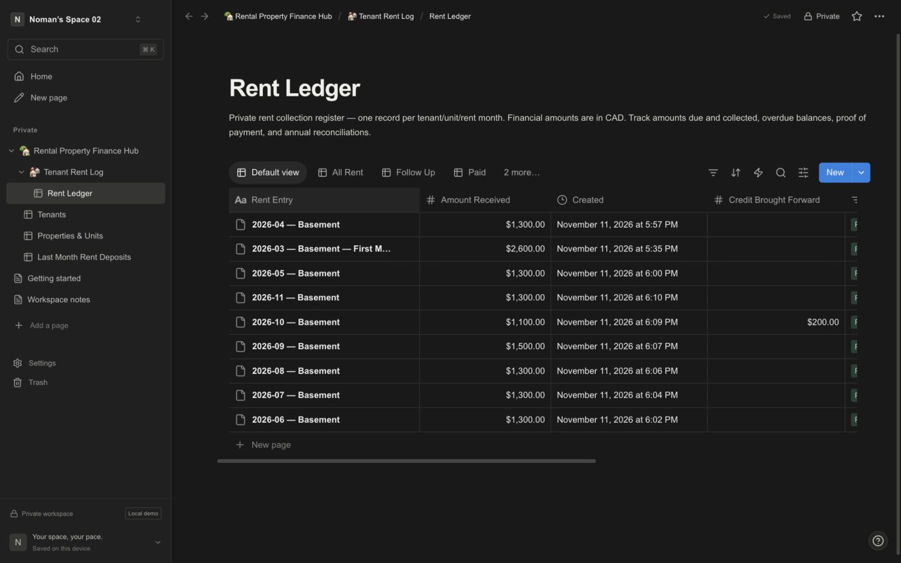

# Slate

A private workspace where notes, databases and runnable playbooks live together, and AI agents can read it all. Live at **https://slate.noman.io**.

Built with Next.js 16 (App Router), React 19, TypeScript, Tiptap, CodeMirror, TanStack Table/Virtual, dnd-kit, Radix, Supabase (Auth, Postgres, Storage) and the OpenNext adapter for Cloudflare Workers.



## What's in it

- **Accounts, no demo.** Sign-up asks only for an email and a password, then opens the new private workspace on a short *Getting started* page with a checklist of first steps. Errors say what to do next (an existing account points to Log in; an unconfirmed email can get a new link). Supabase is the only store.
- **Pages.** A Notion-style editor: `/` commands, Markdown shortcuts, to-dos, tables, code blocks, callouts, images (private uploads) and nested subpages that appear as blocks in their parent. Every page can switch to a Markdown source view; Markdown is the stored format.
- **Databases.** Table, board and list views with filters, sorts, hidden and reordered properties. Property types include status, select, date, currency, relation, rollup and formula. Records open as a side peek or a full page. Databases can live inside pages, and linked views of a database keep views of their own. Export to CSV.
- **Playbooks.** Checklists you can run. Steps are Check, Ask, Say, Decide (branch on an answer), Call (an HTTP API) and Finish, grouped into sections, with typed inputs filled in when a run starts. About 15 templates cover home & property, support, operations and automations. Runs can pause and resume, and every run is saved as a record in the playbook's own Runs database. The builder points out mistakes (a jump to a missing section, a value that doesn't exist, a run that never finishes).
- **AI agents over MCP.** Settings › AI agents creates `slate_…` keys; an agent uses one to search and read pages, databases and playbooks. Read-only; keys can be revoked.
- **Light and dark.** System, Light or Dark, chosen in Settings or the landing page footer. The landing page uses the app's own design tokens, so both look the same.

## Run locally

Use Node.js 22.12 or later (22 LTS recommended) and npm. If you use nvm, `nvm install && nvm use` picks the version in `.nvmrc`. Check `node --version` in the same terminal: installing a newer Node doesn't change terminals that still have an older one first on `PATH`.

Slate needs Supabase to sign in, so start the local stack first. Install the [Supabase CLI](https://supabase.com/docs/guides/local-development/cli/getting-started), start Docker, then:

```sh
npm ci
supabase start
supabase status
test -f .env.local || cp .env.example .env.local
```

Copy the API URL and publishable key from `supabase status` into `NEXT_PUBLIC_SUPABASE_URL` and `NEXT_PUBLIC_SUPABASE_PUBLISHABLE_KEY` in `.env.local`. **Never put a service-role (secret) key in a `NEXT_PUBLIC_` variable.** Then:

```sh
npm run dev
```

Open http://localhost:3000 and register; the workspace is at http://localhost:3000/app. Without the two Supabase variables the front page still loads, but the workspace redirects to the login page, which explains that Supabase isn't connected.

`supabase db reset` re-applies the migrations to an empty database. Local email confirmations are off (`supabase/config.toml`); hosted projects should turn them on. The local config also raises the sign-in rate limit, because the browser tests sign in a fresh account for every test.

### Tailwind / magic-string ESM error

`require() of ES Module .../magic-string/dist/index.mjs not supported` means the shell is on an older Node (for example 20.17). Tailwind needs the ESM `require()` support that is on by default from [Node 22.12](https://nodejs.org/en/blog/release/v22.12.0). Switch Node, stop the failed server with Ctrl+C, and run `npm run dev` again. The dev and build scripts check the Node version first.

## Project layout

| Path | What's there |
| --- | --- |
| `src/app/page.tsx`, `landing.css` | Landing page (adapts to signed-in visitors) |
| `src/app/app`, `src/app/p/[id]` | The workspace (`/app`, `/p/<page id>`) |
| `src/app/auth/*` | Register, log in, forgot/reset password, auth callback |
| `src/app/api/mcp` | MCP endpoint for AI agents |
| `src/app/docs/mcp` | Public MCP setup guide (`/docs/mcp`) |
| `src/app/api/run-request` | Server-side sender for playbook API steps |
| `src/app/api/attachments/[id]` | Signed redirects to private uploads |
| `src/middleware.ts` | Session refresh and sign-in redirect |
| `src/components/workspace-app.tsx` | Workspace shell: sidebar, pages, runs, dialogs |
| `src/components/editor/*` | Tiptap editor, Markdown source pane, playbook step blocks |
| `src/components/database/*` | Database views |
| `src/lib/use-workspace.ts`, `persistence.ts` | Client state, saving and sync with Supabase |
| `src/lib/markdown.ts` | Markdown ↔ blocks (`:::slate` / `:::slate-node` lines) |
| `src/lib/runner.ts`, `runs.ts`, `playbook-*.ts`, `procedures.ts` | Running playbooks, run history, builder model and checks, templates |
| `src/lib/agent-tools.ts`, `mcp.ts`, `agent-keys.ts` | Agent tools, MCP protocol, agent keys |
| `supabase/migrations`, `supabase/tests` | Schema, policies, functions; pgTAP tests |
| `tests/*.test.ts`, `tests/browser`, `tests/fixtures/seed.ts` | Unit tests, Playwright suite, example rental workspace |

The `slate` names inside saved data (`:::slate` blocks, `slate_` key prefix, `slate-*` browser storage keys) are part of the stored format; renaming them would break existing pages, keys or drafts.

## Data and security

Workspaces, pages, documents, databases, properties, records, cell values, views, relations, attachments and agent keys are separate PostgreSQL tables. Record values are queryable rows; document content and view configuration use JSONB. The whole state is never stored in one JSON column.

Every application table has owner-scoped Row Level Security. Composite foreign keys keep a page, value or relation from crossing workspace boundaries. A deferred trigger rejects page cycles; relation targets must belong to their configured database; deleting a record removes its relation links. Workspaces are owner-only: there are no invitations, public pages or shared roles.

`load_workspace_state` assembles a consistent snapshot from the normalized tables. `save_workspace_state` applies a whole snapshot in one transaction and bumps a revision under a row lock, so a stale tab gets a conflict instead of overwriting another tab's changes. The client keeps unsynced changes in a per-account local outbox and warns before closing a tab with unsaved edits. On reload it replays that draft only if its base revision still matches the server; otherwise the draft is offered as a download rather than overwriting newer data. Snapshot sync is deliberately simple; incremental sync is future work for very large workspaces.

Session cookies use `@supabase/ssr`. Middleware refreshes the session and sends signed-out visitors to the login page (or answers `401` for `/api/*`); RLS stays the real authorization boundary. Registration, login, logout and password recovery use Supabase Auth. Links in sign-up and password-reset emails land on `/auth/confirm`: a page with a button that posts the token to `/auth/confirm/verify`, which calls `verifyOtp` on the server and sets the session. Auth redirects are relative, so they stay on the address the visitor is using (under `next dev --hostname 0.0.0.0`, absolute redirects would jump to `0.0.0.0` and drop the cookies). Open the dev server at `http://localhost:3000`.

**Attachments.** The private `attachments` bucket takes images, PDFs and text files up to 20 MB, under keys that start with the owning workspace id. Documents keep stable `/api/attachments/:id` URLs; that endpoint checks ownership, the parent page and the object path, then redirects to a short-lived signed URL with private, no-store headers. A failed metadata insert rolls the upload back.

**Playbook API steps** are sent by `/api/run-request`, never from the browser. It requires a signed-in user, drops cookies and forwarding headers, doesn't follow redirects, blocks private and local addresses in production, and caps requests (200 KB), responses (1 MB) and time (15 s). Secret headers are masked in run history and links.

**AI agents (MCP).** Keys are random `slate_…` secrets made in the browser; only a SHA-256 hash is stored, so a key is shown once. `/api/mcp` skips the session middleware: the route checks the key itself through `agent_workspace_state`, which returns the key owner's workspace read-only. It speaks stateless MCP over Streamable HTTP (one JSON-RPC message per POST; protocol versions 2025-06-18, 2025-03-26 and 2024-11-05) and offers five read-only tools: `search_workspace`, `read_page`, `list_databases`, `query_database` and `list_playbooks`. Page content is returned as clearly marked workspace data, not instructions. The public guide at [`/docs/mcp`](https://slate.noman.io/docs/mcp) (`src/app/docs/mcp`) has setup steps for Claude Code, Claude Desktop, Cursor, VS Code, Codex and other clients, and a tools reference generated from `AGENT_TOOLS`, so it always matches the server. To connect Claude Code:

```sh
claude mcp add --transport http slate https://slate.noman.io/api/mcp --header "Authorization: Bearer slate_YOUR_KEY"
```

## Development checks

```sh
npm run typecheck
npm run lint
npm test
npm run build
npm run build:worker
supabase test db
npx playwright install chromium
npm run test:e2e
npm run test:auth
```

- **Unit tests** (`npm test`, Vitest): Markdown and editor round trips, page blocks, databases and formulas, page duplication and the page tree, playbook model, checks and runner, API request rules, agent tools, attachments, and the deploy configuration check.
- **Database tests** (`supabase test db`, pgTAP): registration bootstrap, RLS isolation, unauthorized inserts, snapshot ownership, stale-save rejection and relation rules.
- **HTTP auth test** (`npm run test:auth`): against local Supabase only. Creates temporary accounts and checks registration (and the starting Getting started page), login, session refresh, workspace bootstrap, nested-page and relational persistence, per-view column order, cross-account isolation, stale revisions, password changes, reauthentication and logout, then removes the accounts.
- **Browser tests** (`npm run test:e2e`, Playwright): need `supabase start`. Each workspace test creates a throwaway account holding the example rental workspace (`tests/fixtures/seed.ts`), signs in through the login form, and deletes the account afterwards. `onboarding.e2e.ts` signs up through the real form, checks the Getting started page and the error messages, and fakes a confirm-your-email answer to cover the "Check your inbox" screen. The suite starts its own dev server on port 3100 wired to `supabase status`, so stop any other `next dev` in this folder first (Next allows one per project). Set `PLAYWRIGHT_BASE_URL` to test a server you run yourself. API steps are stubbed at `/api/run-request`.

Database, auth and browser tests need Docker. Set `SUPABASE_TEST_WORKDIR` to use an isolated Supabase CLI checkout. In CI, `.github/workflows/ci.yml` runs typecheck, lint, unit tests, the Worker build, database tests and the HTTP auth test; `.github/workflows/browser.yml` starts Supabase and runs the Playwright suite.

## Deployment

Pushing to `main` deploys both halves, each by its own service:

- **App → Cloudflare Workers Builds.** Cloudflare builds the repo and deploys the Worker to **https://slate.noman.io**.
- **Database → Supabase GitHub integration.** Supabase applies new files in `supabase/migrations` to `slate-production`.

Neither needs GitHub secrets. The two run side by side, so for a moment the new app can meet the old schema: keep migrations additive (add tables and columns; don't rename or drop what the running app still uses).

### App: Cloudflare Workers Builds

In Cloudflare, **Workers & Pages → Create application → Import a repository**, then pick this repo:

| Setting | Value |
| --- | --- |
| Worker name | `slate-workspace`: must match `name` in `wrangler.jsonc`, or the build fails |
| Production branch | `main` |
| Build command | empty (`npm run deploy` builds) |
| Deploy command | `npm run deploy` |
| Preview builds | off: a preview would use the production database |
| Build variables | `NEXT_PUBLIC_SUPABASE_URL`, `NEXT_PUBLIC_SUPABASE_PUBLISHABLE_KEY`, and `NEXT_PUBLIC_APP_URL` = `https://slate.noman.io` |

Cloudflare installs dependencies itself and takes the Node version from `.nvmrc`. `npm run deploy` runs `scripts/deploy-worker.mjs`: it checks that the Supabase key is a public one, builds with OpenNext, and deploys with the Supabase values bound to the Worker runtime too (the middleware reads them there). The URL and key must be present at build time, because Next.js embeds `NEXT_PUBLIC_` values in browser assets.

`wrangler.jsonc` attaches the Worker to `slate.noman.io` as a [Workers Custom Domain](https://developers.cloudflare.com/workers/configuration/routing/custom-domains/); `noman.io` must be a zone in the same Cloudflare account, with no existing `slate` DNS record. If the domain doesn't answer after the first deploy, add it under the Worker's **Settings → Domains & Routes**.

### Database: Supabase GitHub integration

In Supabase, **slate-production → Project Settings → Integrations → GitHub**, connect this repo:

| Setting | Value |
| --- | --- |
| Working directory | `.` (the folder that contains `supabase/`, here the repo root) |
| Deploy to production | on, production branch `main`: new migrations are applied on every push to `main` |
| Automatic branching | off (it needs the Pro plan): otherwise each pull request gets its own billed database |

The integration only applies migrations. The `[auth]` settings in `supabase/config.toml` (such as the raised local sign-in limit) stay local; production auth is configured in the dashboard.

### One-time Supabase dashboard settings

These live only in the dashboard:

1. **Authentication → URL Configuration:** set the Site URL to `https://slate.noman.io` and add these redirect URLs (the `localhost` one lets `npm run dev` use this project too):
   - `https://slate.noman.io/auth/confirm`
   - `https://slate.noman.io/auth/callback`
   - `http://localhost:3000/auth/confirm`
2. **Authentication → Email Templates:** paste `supabase/templates/confirmation.html` into *Confirm signup* and `supabase/templates/recovery.html` into *Reset password*. Their links go to `/auth/confirm`, which uses the one-time token only when its button is pressed (mail scanners such as Outlook Safe Links open every link and would otherwise use it up) and verifies it on the server, so the link works in any browser or device.
3. **Authentication → SMTP Settings:** add your own email sender (Resend, Postmark, …). Supabase's built-in sender only delivers to members of your Supabase team, a few emails an hour.

After the first deploy, open https://slate.noman.io, sign up, confirm the email and check that you land on the *Getting started* page.

### Deploying by hand

Builds and deploys can also run from your machine, for example to debug a failed build:

```sh
npm run build:worker   # build only
npm run preview        # build and serve the Worker locally through Wrangler
npm run deploy:check   # validate the Supabase settings without deploying
npm run deploy         # build and deploy
```

`npm run deploy` reads `.env.production.local` ahead of `.env.local`, so put the production values there, and sign in with `npx wrangler login`. To apply migrations by hand: `supabase link --project-ref <project ref>`, then `supabase db push`. Running the app locally never touches a remote project.

## Scope and known limits

- Single owner per workspace; no sharing or live collaboration. Sync sends whole snapshots with optimistic revision checks; no realtime merging or incremental loading.
- Reloading or leaving within about a second of an edit, while that save is still in flight, can turn the latest edit into an "unsynced draft" download instead of showing it after reload.
- Removing an image block doesn't delete the stored file. Deleting pages or workspaces removes attachment metadata, but stored objects aren't garbage-collected.
- Next.js 16 warns that the `middleware` file convention is deprecated in favour of `proxy`; it still works.
- Production sign-in and cross-account isolation should be checked against your own Supabase project after deploying.

## Last verified

On 14 November 2026, locally: TypeScript, ESLint, 100 unit tests, and the 42-test Playwright suite against a local Supabase stack, including signing in, the example workspace, and an agent key reading the workspace over MCP with no session. The pgTAP suite (14 checks), the HTTP auth test and the Worker build weren't rerun in that pass.
